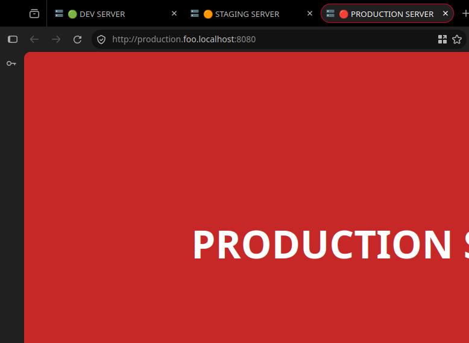
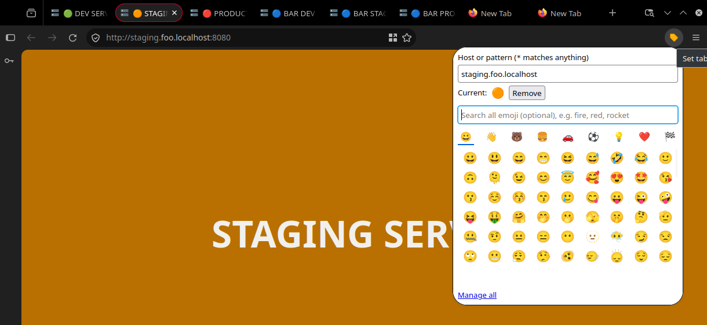
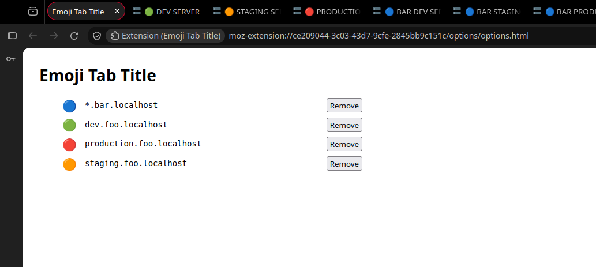
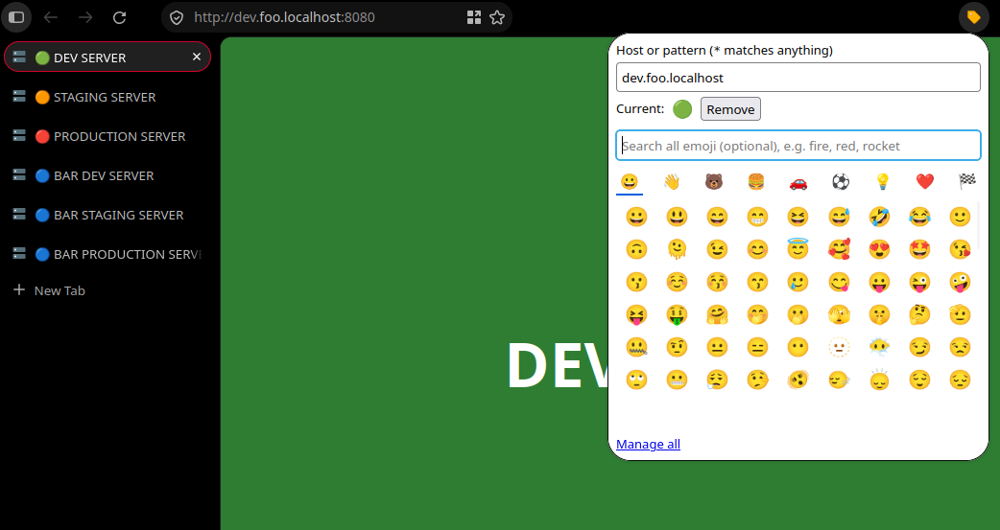

# Emoji Tab Title

A Firefox extension that prefixes the title of a site's tabs with an emoji you choose for that domain.

Use it to tell apart, for example, different environments serving the same application
(production vs. staging vs. local).

- Pick an emoji for the current site from the toolbar popup, or manage patterns on the options page.
- Everything is stored locally in the browser (`storage.local`). Nothing is collected or sent anywhere.

## Screenshots

The site's own favicon is untouched; only the title gains an emoji.



Pick an emoji for the current site from the toolbar popup:



Rules can use `*` to cover a family of hosts, such as `*.bar.localhost`, and are managed on the options page:



It works with vertical tabs too:



## Development

```
make install     # npm install
make test        # unit tests
make lint        # eslint + web-ext lint
make run         # launch in a temporary Firefox profile
make build       # test + lint + package into dist/
```

## Rebuilding generated code (for add-on reviewers)

`src/lib/emoji-data.js` is generated from the `emojibase-data` package by
`scripts/build-emoji-data.js`; no other code is minified or transformed.

```
npm install
make emoji-data   # regenerates src/lib/emoji-data.js
make build        # produces dist/*.zip from src/
```

Requires Node.js 18+ and npm.
